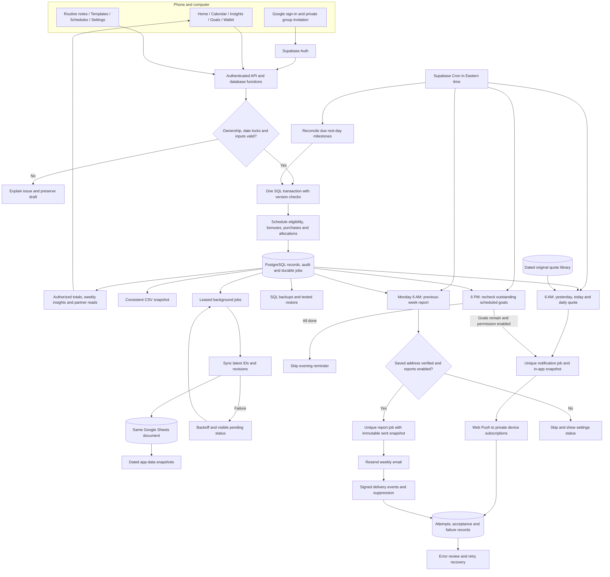
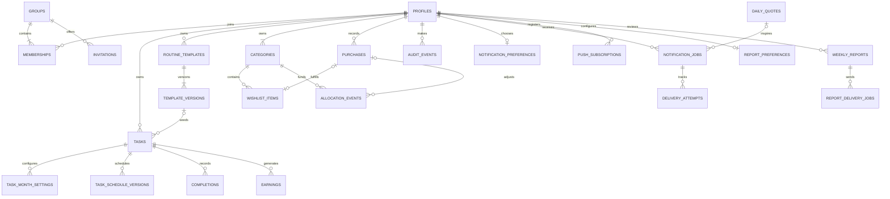

# HNF backend: storage, rewards, reporting, and reminders

Approved planning architecture, September 21, 2026. PRD.md is authoritative. PostgreSQL/Supabase and the full technology plan are approved; this consolidated workflow is part of the approved planning handoff. No implementation or live connections have been made. All local dates and scheduled jobs use America/New_York; daily phone notifications and Monday weekly email are separate channels.

## Recommendation and tradeoffs

Use managed PostgreSQL through the approved Supabase provider as authoritative storage and synchronize Google Sheets for analysis. For two people the volume is small; correctness, ownership, and recovery are the reasons to choose SQL. A completion, its recalculated bonus, the audit record, and queued export can commit together or all fail together. SQL constraints can enforce one completion per task/date. No balance is accepted from a phone or spreadsheet cell. Savings allocations and purchase changes share the same transactional accounting rules.

Sheets plus Apps Script is a credible alternative for a small personal prototype. The API supports atomic batches, and Apps Script can serialize script-controlled updates with locks. It is not inherently unusable. However, all writers must follow those rules; direct cell edits can bypass application validation. Record relationships, immutable history, concurrency, account permissions and durable retry queues become custom conventions. A sheet-first implementation therefore saves a database service but does not necessarily save development or maintenance time for this app.

Postgres adds account configuration, schema migrations, permissions, backups, and a reporting integration. The owner/coding maintainer must monitor failures, manage credentials, maintain dependencies and test restores. Sheets export is an analysis copy, not a complete database backup.

## Complete proposed service flow

All privileged credentials stay in backend secret storage. Database access uses least privilege. Owners write their own records; group members may read shared application records. Push messages go to each user’s own opted-in device subscriptions, not automatically to their partner. Operational logs, credential data, and device subscriptions are not shared profile information.

## How information is stored

Each table contains individual records linked by stable identifiers. Dollars are integer cents; dates used for habits are New York calendar dates; event timestamps are UTC. Browser clocks are not trusted for eligibility.

| Table | Main stored fields | Relationship / rule |
|---|---|---|
| profiles | user_id, display_name, setup_completed_at | Identity managed by authentication service |
| groups / memberships | group_id, user_id, joined_at | Two-person private group; membership controls reads |
| invitations | token_hash, group_id, expiry, redeemed_at | One-time redemption; raw token not stored |
| tasks | task_id, owner_id, title, description, start_date, archive_date | Belongs to one person; no completion before start |
| task_month_settings | task_id, month, reward_cents, goal, unit, title_snapshot | One applicable monthly record; first-day rules checked server-side |
| completions | task_id, local_date, completed, version | Unique task/date; owner inferred and validated through task |
| earnings | entry_id, owner_id, task_id, earned_date, type, cents, qualification_key, revision, active | Derived base/bonus entries; invalidated entries retained with inactive status |
| purchases | purchase_id, owner_id, date, title, cents, note, version, deleted_at | Positive cents; deletions preserve audit; balance may become negative |
| audit_events | event_id, actor_id, entity_id, old_value, new_value, timestamp | Append-only record of corrections |
| background_jobs | job_id, type, source_id, revision, state, attempts, next_attempt_at, lease_until | Durable export queue; leased jobs recover after worker failure |
| sheet_sync | destination_id, record_id, row_reference, last_revision, last_success_at | Stable IDs prevent duplicate or stale exports |
| notification_preferences | user_id, morning_time, evening_time, push_enabled | Confirmed 6 AM / 6 PM New York; user controls permission/preferences |
| daily_quotes | quote_id, text, author, provenance, display_date | Original HNF messages or properly sourced/licensed quotes; distinct daily assignment |
| notification_jobs | user_id, local_date, kind, channel, quote_id, snapshot_revision, state, provider_id | Unique user/date/type/channel; no duplicate logical sends |
| delivery_attempts | job_id, attempt, idempotency_key, provider_status, timestamp, error | Track accepted vs failed; accepted by push service does not prove displayed/read |
| push_subscriptions | user_id, device_id, endpoint, keys, status | Required for approved push; secret keys/endpoints never exported to Sheets |

Additional approved feature storage:

| Table | Main fields | Rule |
|---|---|---|
| task_schedule_versions | task_id, month, weekdays, effective date, revision | Rest-day eligibility and immutable historical denominator; month locks |
| routine_templates / template_versions | owner, title, notes, suggested schedule/rate, revision, archive state | Copies are independent; source reference never live-overwrites tasks |
| categories | owner, stable category key | Exactly the seven named category types per user |
| wishlist_items | category_id, title, estimated_cents, URL, notes, status, purchase_id, revision | Active unpurchased items sum to category target |
| allocation_events | owner, category, signed_cents, reason, move_id/purchase_id | Earmark existing wallet funds; audit reversals and prevent double allocation |
| weekly_reports | owner, week_start, source revision, generated_at, snapshot, status | In-app metrics read source data; sent report is an immutable audit snapshot |
| report_preferences | owner, verified address, enabled, verification status | Only own settings editable; no automatic sends to unverified addresses |
| report_delivery_jobs | owner, week_start, type, provider id, attempts, state | Unique weekly report job; opt-out/recipient rechecked before sending |

Daily/weekly/monthly totals and available balance are queries or rebuildable summaries, not independent amounts users can edit. Available balance = active earned cents minus active purchase cents.

## Example: correcting a day

1. A signed-in user unchecks their own gym completion dated in the current month. Show the honesty reminder.
2. The backend validates the date and expected record version, then locks relevant records for this transaction.
3. Update the completion, reconstruct that task's current-month streaks, and derive the new base/bonus entries. A previously qualifying day-14 bonus can be invalidated; a later missed day alone does not invalidate it.
4. Save the correction, earnings revisions, audit record, and export job in one transaction. Any failure rolls back the entire change.
5. Return authoritative totals to the app. Partner views refetch or receive an authorized update. A negative balance remains visible if earnings were already spent.
6. Export the latest revision to matching sheet IDs. A stale job cannot overwrite a newer correction. Failure does not undo the app save; retry and reconcile.

## Morning and evening phone notifications

Confirmed: phone notifications only, on iPhone. Morning at 6 AM and evening around 6 PM America/New_York with daylight saving. This timezone now also governs accounting days and month boundaries. No daily progress emails and no silent email fallback. Weekly reports use email as a separate approved feature.

The morning push provides a concise previous-day result and opens a full in-app update containing completed/eligible count, base/bonus earnings, today's goals, encouragement and a distinct daily quote. The full content is stored in notification_jobs/update history and mirrored to Sheets. A stored original HNF quote library avoids a paid AI service; proposed one year of unique messages initially, replenished before exhaustion. Retries preserve the date's selected quote.

The evening worker rereads current goals just before sending. Proposed behavior is to skip when all goals are complete; otherwise list a count and attainable remaining rewards, opening the current checklist. Distinguish a send-time snapshot from live totals: later corrections update app data but cannot rewrite an already displayed push. No automatic resend after corrections.

Jobs use a unique user/date/kind/channel key and leased execution. A scheduler checks every few minutes and does not require an open app. Avoid stale retries after proposed cutoffs (noon for morning, 9 PM for evening). Permission denial, removed subscriptions, expired endpoints and offline devices must have explicit handling. Invalid endpoints are deactivated; temporary errors use backoff. Exactly-once device display and exact arrival time cannot be guaranteed. A push-service acceptance is not a read receipt.

For iPhone, onboarding explains Home Screen installation and asks for notification permission only after the user taps Enable notifications. Supported iOS version and behavior must be tested on the actual phone. Notification permissions remain per device. If denied, show setup instructions and retain the full daily update inside the app, without emailing it.

Routine descriptions, notification preferences and content/history are app records and sync to Sheets; authentication tokens, push private keys and subscription secrets do not.

## Weekly reports and goal transactions

At Monday 6 AM Eastern, generate the preceding Monday–Sunday report using scheduled opportunities and authoritative earnings. A week can cross months; monthly streak reset does not split it. Verify the saved recipient and current opt-in, create one owner/week/type delivery job, and send via Resend. Record the provider id, signed delivery events, bounce/complaint suppression and attempts. Do not equate accepted with read. Retry with provider idempotency; reconcile an ambiguous send before repeating after the provider window expires. Proposed stale cutoff: Monday noon; show failed/skipped status instead of mailing weeks of catch-up reports. Keep the sent snapshot unchanged if current-month corrections later alter the in-app report.

A category target is the sum of active unpurchased item estimates. Allocation events earmark wallet money without spending it. A linked purchase transaction records the actual cost once, updates item state, consumes category allocation, writes audit and queues all affected exports. Editing/deleting the purchase reverses/adjusts those effects transactionally. Earnings corrections never silently erase allocations: show the exact overallocated amount and block new funding until resolved.

Scheduled habits use 14/28-calendar-day windows anchored at the first completed due occurrence of each run. Only due occurrences can earn base rewards; a missed due day resets the run; rest days do not. Milestones on rest days are evaluated by scheduled reconciliation and idempotent reads. All windows end at month-end. Exact rules and examples are in PRD.md.

## Google Sheets reporting

Mirror the current tables listed here and in PRD.md, including routines, templates, schedule versions, goals, allocations, weekly reports, daily update content and nonsecret delivery/preferences records. Exclude credentials and device tokens. Export all results and corrections after commits; target under a minute during normal operation, to be verified. Protect app-managed raw tabs from casual manual edits; give separate user-owned analysis tabs for pivots, charts, filters and CSV export. Two-way sheet edits require a separate import validation/conflict design and are not part of this recommendation.

See [current stack and setup](stack-and-setup.md) for the complete-data Sheets mirror, versioned backup proposal, setup instructions and exact remaining approvals. A live mirror alone is insufficient for rollback; separate restorable SQL exports are still needed.

## Costs and operating limits checked September 21, 2026

- Supabase Free: $0/month, 500 MB database, 50,000 monthly active users, 500,000 edge function invocations. Free projects may pause after a week of inactivity; automatic backups are not included. Pro starts at $25/month. Free is plausible for two people but is not an uptime guarantee.
- Supabase Cron can run SQL/functions or call HTTP endpoints; use it to invoke trusted workers. Avoid one service per task.
- Resend is approved for weekly email only. Free currently includes 3,000 emails/month, 100/day; two users need about 8–10 weekly report emails monthly plus verification. A verified owner-controlled domain is required and may cost money if not already owned. Google sign-in handles account authentication separately.
- Standard Web Push avoids a separate paid messaging service at this scale, but compatibility with the selected worker runtime and actual iPhone must be verified. No exact-time delivery guarantee.
- Google Sheets API has no additional usage cost but has quotas and requires backoff on quota errors. Sheet-first Apps Script reminders also have execution/sending limits; time-based triggers can be randomized within their scheduled hour.
- Cloudflare Pages and Google sign-in are selected. Exact sender domain, backup executor/destination and named maintainer are release setup gates. Do not treat this as a verified $0 complete deployment.

For tomorrow's target, provider access, sender-domain verification, iPhone Home Screen/permission setup, reward tests, scheduled push tests, and restore/export checks are release dependencies. A small private launch may be feasible, but all of the newly expanded scope is not promised for tomorrow. Any staging or deferral needs the user's agreement.

## Acceptance checks before launch

- Concurrent completion writes and corrections preserve one authoritative result and correct bonus amounts; cross-user writes fail.
- Job retries/out-of-order processing do not duplicate earnings or export rows.
- Morning content uses yesterday in New York, including at month/year boundaries; February and daylight saving tests pass.
- Evening sends only when goals remain at send time; retries after completion skip the message.
- Quotes differ across successive dates; retried delivery uses the same quote and content.
- Duplicate scheduler runs do not create duplicate logical messages; disabled channels and expired device subscriptions are skipped.
- Push can arrive while the app is closed on the supported iPhone setup; failed sends are visible in operations records.
- Weekly reports: correct complete-week boundaries, verified saved recipient, opt-out, correction-aware in-app metrics and immutable sent snapshots; repeated jobs do not duplicate logical sends.
- Goals: allocations never create earnings; purchase/refund-style reversals preserve a single debit; corrections expose shortfalls without deleting plans.
- Sheet totals and expanded feature records reconcile against SQL after corrections and outages; a database export restores successfully before calling backups ready.

## Official sources
- [PostgreSQL transactions](https://www.postgresql.org/docs/current/tutorial-transactions.html)
- [Supabase pricing](https://supabase.com/pricing)
- [Supabase row-level security](https://supabase.com/docs/guides/database/postgres/row-level-security)
- [Supabase Cron](https://supabase.com/docs/guides/cron)
- [Sheets API limits](https://developers.google.com/workspace/sheets/api/limits)
- [Apps Script time triggers](https://developers.google.com/apps-script/guides/triggers/installable)
- [Resend pricing](https://resend.com/pricing)
- [Resend domain verification](https://resend.com/docs/dashboard/domains/introduction)
- [WebKit web push support](https://webkit.org/blog/13878/web-push-for-web-apps-on-ios-and-ipados/)
