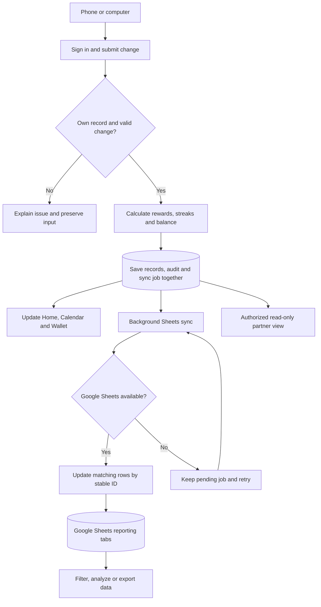

# Proposed backend and Google Sheets workflow

Initial workflow, superseded in detail by backend-architecture.md and stack-and-setup.md. PostgreSQL is approved; phone-only notifications and complete app-data mirroring are now required. Specific providers remain undecided. Google Sheets is proposed as a one-way reporting copy, with the application database authoritative. No live document has been created or connected.

## Proposed reporting tabs
- Daily results: stable record ID, person ID/name, local date, month, task ID/title, completed flag, applicable goal and unit, reward rate, base earnings, bonus earnings, streak length, updated timestamp. Include incomplete eligible days so consistency can be analyzed, not only successful days.
- Earnings: stable entry ID, person, task, earning date, base/bonus type, amount, active/reversed status, revision.
- Purchases: stable purchase ID, person, date, title, amount, note, active/deleted status, revision.
- Summary: person, date, earned today/week/month, lifetime earned/spent, available balance, last synced timestamp.
- Tasks and settings: personal tasks, descriptions, active dates, monthly reward rates and goals.
- Change history: completion, settings and purchase corrections with actor and timestamp; no credentials or authentication secrets.

## Consistency and failure behavior
Propose queued sync after every successful mutation, normally within a minute, with a visible last-sync timestamp and retry/error state. This is a target to validate against the selected stack, not a guarantee. Sync permissions failures require reconnecting access; transient failures use bounded exponential backoff. Application writes remain durable while Sheets is unavailable.

Jobs read the latest authoritative revision, update stable IDs, and cannot let stale retries replace newer corrections. Corrections update affected daily results, earnings, and summaries; deletions mark exported records accordingly. No duplicate financial entries on retry. Export titles and notes as literal values to avoid interpreting user text as spreadsheet formulas.

Use app-managed data tabs plus separate analysis tabs for user formulas, filters and pivots. Direct edits to reporting tabs do not change app balances; app-managed data may be refreshed. Two-way editing is outside this proposal and needs separate conflict rules if requested.

Google access must be restricted to the intended spreadsheet and authorized users. Google credentials remain on the trusted backend. Spreadsheet owner/link, access setup, and choice of new versus existing document remain open.

Verify successful sync, correction propagation, purchase deletion, duplicate retry, out-of-order jobs, quota errors, lost access, and reconciliation after an outage. Compare sheet totals against app totals before launch.

Official API reference: https://developers.google.com/workspace/sheets/api/reference/rest/v4/spreadsheets.values/batchUpdate
